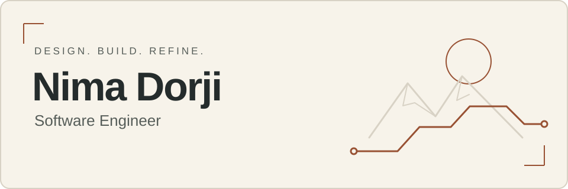

<picture>
  <source media="(prefers-color-scheme: dark)" srcset="./assets/banner-dark.svg" />
  
</picture>

# Hi, I'm Nima.

I build web experiences and the systems that support them. My work brings together thoughtful interfaces, responsive design, accessibility, and reliable delivery.

[Featured work](#featured-projects) · [Skills](#skills) · [GitHub activity](#github-activity)

## About Me

I'm a software engineer interested in making useful products feel clear and work well. I enjoy the details that connect design and engineering: how an interface adapts to a phone, how motion guides a user, and how checks help a team ship with confidence.

## Featured Projects

### 01 / [108.bt](https://108.bt)

A digital experience bringing together prayers and personal memories around 108 chortens, with participation in Dzongkha and English.

**My contribution:** responsive interface refinements, accessibility improvements, interactive animation, and automated build validation.

[Explore the live experience ↗](https://108.bt)

## Skills

Technologies used in my engineering work.

  
  
  
  
  
  

**What I put into practice:** responsive layouts · accessible interactions · interface animation · build and type checks.

## GitHub Activity

[View my contributions and recent activity →](https://github.com/nimadoorji2003-pixel?tab=overview#js-contribution-activity)

[Browse my public repositories →](https://github.com/nimadoorji2003-pixel?tab=repositories)

---

Built with care, one detail at a time.
