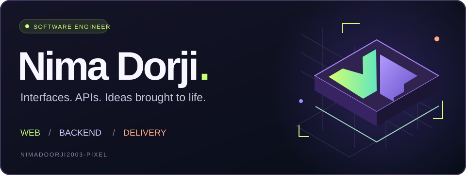
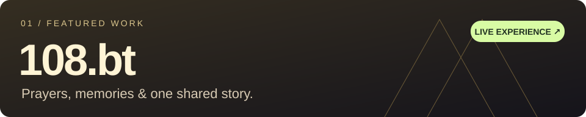
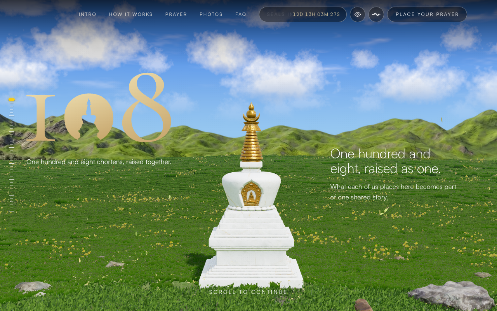
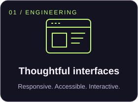
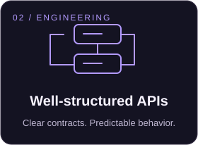
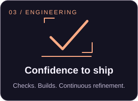

<picture>
  <source media="(max-width: 600px)" srcset="./assets/hero-mobile.svg" />
  
</picture>

  <b>Full-stack development</b> &nbsp; / &nbsp; <b>Interactive web experiences</b> &nbsp; / &nbsp; <b>Reliable delivery</b>

  <a href="#featured-projects">Selected work</a> &nbsp;·&nbsp;
  <a href="#tech-stack">Tech stack</a> &nbsp;·&nbsp;
  <a href="#github-activity">Activity</a>

## About Me

I'm **Nima Dorji**, a software engineer working across web interfaces, backend APIs, and the tooling that helps teams ship. I enjoy turning complex flows into clear experiences, from responsive layouts and purposeful motion to reliable services and automated checks.

## Featured Projects

### [108.bt ↗](https://108.bt)

A digital experience connecting prayers and personal memories around 108 chortens, with participation in Dzongkha and English.

**My work:** responsive interface refinements, accessibility improvements, interactive animation, and automated build validation.

`Next.js` · `React` · `TypeScript` · `Tailwind CSS` · `GitHub Actions`

**[Visit the live experience →](https://108.bt)**

## Tech Stack

### Web &amp; interaction

TypeScript · JavaScript · React · Next.js · Tailwind CSS

### APIs &amp; data

Node.js · NestJS · PostgreSQL · Redis

### Build &amp; delivery

Docker · Git · GitHub Actions · Bun

## How I Build

  
  
  

## GitHub Activity

[Contribution history →](https://github.com/nimadoorji2003-pixel?tab=overview#js-contribution-activity) &nbsp;·&nbsp; [Public repositories →](https://github.com/nimadoorji2003-pixel?tab=repositories)

---

Thoughtful interfaces. Solid foundations. Always refining.

